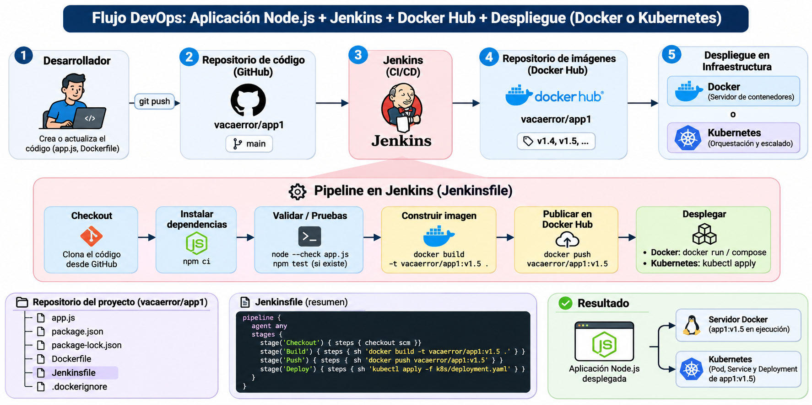

# Flujo DevOps de app1 — Pascual Bravo 2026

De código a producción con GitHub, Jenkins, Docker y Docker Hub sobre el servidor 10.0.0.238.

📄 **Diapositivas en PDF:** [Presentacion-DevOps-app1.pdf](Presentacion-DevOps-app1.pdf)



---

## 1. Resultado

Un cambio en una rama llega solo a producción: el desarrollador abre un pull request, Jenkins lo valida y, al hacer merge, la nueva versión se construye, se publica en Docker Hub y se despliega sin pasos manuales.

| Cifra | Qué significa |
|---|---|
| **3** versiones | v1.0.1, v1.0.2 y v1.0.3 desplegadas automáticamente |
| **2** pull requests | validados por Jenkins antes de permitir el merge |
| **~1 min** | desde el merge hasta la app nueva en 10.0.0.238:3000 |
| **0** pasos manuales | después del merge |

## 2. Arquitectura

```
Desarrollador ──► GitHub ──► Jenkins ──► Docker Hub ──► Servidor 10.0.0.238
 rama feature/*   main        app1-cicd   vacaerror/app1   contenedor app1 :3000
 + pull request   protegida   (cada 2 min) 1.0.N y latest
```

- Jenkins y la aplicación viven en el mismo servidor; Jenkins usa el Docker local para construir y ejecutar.
- 10.0.0.238 es una IP privada: GitHub no puede avisarle a Jenkins (webhook), por eso Jenkins consulta GitHub cada 2 minutos.

## 3. Inventario

| Componente | Qué es | Dónde |
|---|---|---|
| Código | Node.js 22 + Express: login, /api/usuarios, /api/salud | este repositorio |
| Repositorio | GitHub público, rama `main` protegida | github.com/vacaerror1985/app1 |
| CI/CD | Jenkins 2.492, job multibranch `app1-cicd` | 10.0.0.238:8080 |
| Pipeline | `Jenkinsfile` declarativo con 7 etapas | raíz del repositorio |
| Registro | Docker Hub, repositorio `vacaerror/app1` | hub.docker.com/r/vacaerror/app1 |
| Ejecución | Contenedor Docker `app1` con reinicio automático | 10.0.0.238:3000 |
| Secretos | Credenciales `github-token` y `dockerhub` | Jenkins › Credentials |

## 4. Flujo de trabajo: todo cambio entra por pull request

1. **Rama:** crear `feature/nombre` desde `main` actualizada.
2. **Pull request:** push de la rama y PR hacia `main` en GitHub.
3. **Validación:** Jenkins construye y prueba; el PR recibe ✔ o ✘.
4. **Merge:** GitHub solo permite el merge con ✔; luego el despliegue es automático.

```bash
git checkout main && git pull
git checkout -b feature/login
# ... editar ...
git commit -am "Agrega login"
git push -u origin feature/login
```

Un push directo a `main` es rechazado por GitHub (`GH006: Protected branch update failed`), también para el dueño del repositorio.

## 5. Etapas del Jenkinsfile: las ramas se prueban, solo main se despliega

| Etapa | Ramas y PR | main |
|---|---|---|
| Obtener código de GitHub | Sí | Sí |
| Calcular versión | `1.0.0-pr-N.B` | `1.0.N` |
| Construir imagen Docker | Sí | Sí |
| Probar imagen en contenedor temporal | Sí | Sí |
| Publicar en Docker Hub | No | Sí |
| Desplegar en 10.0.0.238:3000 | No | Sí |
| Crear tag `vX.Y.N` en GitHub | No | Sí |

La prueba arranca la imagen recién construida y llama a `/api/usuarios`; si no responde en 20 segundos, el build falla y nada se publica.

## 6. Versionamiento

`v1.0.3` = **1.0** (`version` en `package.json`) + **.3** (número de build de `main`).

El mismo número aparece en el tag de GitHub (`v1.0.3`), en la imagen de Docker Hub (`vacaerror/app1:1.0.3`, más `latest`) y en el build de Jenkins (`#3 v1.0.3`). Para un cambio grande se sube la versión en `package.json` dentro del PR (por ejemplo `1.1.0`).

## 7. Seguridad

**Aplicado**
- `main` protegida: pull request obligatorio, check de Jenkins, sin force push.
- Tokens de GitHub y Docker Hub como credenciales de Jenkins, ocultos en los logs.
- `docker login --password-stdin` y `docker logout` al terminar.
- Los PR nunca publican ni despliegan.

**Pendiente**
- Usuarios y contraseñas de demo escritos en `app.js`.
- Token de GitHub clásico con permisos amplios → cambiar a uno *fine-grained* solo para este repo.
- El contenedor corre como root; no hay escaneo de vulnerabilidades.

## 8. Lecciones: tres problemas reales

| Problema | Causa | Solución |
|---|---|---|
| Jenkins no podía usar Docker | Carpeta del proyecto de root; usuario `jenkins` fuera del grupo `docker` | `chown` y `usermod -aG docker jenkins` |
| Jenkins no veía ramas | Plugin `github-api` incompatible (`NoSuchFieldError: SNAKE_CASE`) | Actualizar `github-api` a 1.330 |
| 106 plugins caídos | La actualización trajo 25 dependencias que exigen Jenkins 2.504+ (el servidor tiene 2.492) | Revertir desde los respaldos `.bak` |

**Lección:** actualizar primero el core de Jenkins, probar en un Jenkins de pruebas y respaldar `/var/lib/jenkins` antes de tocar plugins.

## 9. Lo que falta

### Calidad y seguridad del código

| Práctica | Hoy | Recomendado |
|---|---|---|
| Pruebas | Solo prueba de arranque | Jest + supertest con `npm test` en el pipeline |
| Lint | No hay | ESLint obligatorio en cada PR |
| Análisis | No hay | SonarQube con quality gate |
| Imagen | Sin escaneo | Trivy: falla con CVE críticas |
| Dependencias | Sin control | `npm audit` y Dependabot |
| Secretos | Usuarios demo en `app.js` | Variables de entorno o gestor de secretos |
| Dockerfile | root, sin package-lock | `npm ci`, `USER node`, `HEALTHCHECK` |

### Operación y plataforma

| Práctica | Hoy | Recomendado |
|---|---|---|
| Disparo | Polling cada 2 min | Webhook de GitHub (Jenkins público o relay) |
| Ambientes | Solo producción | QA y producción con aprobación |
| Rollback | Manual | Redesplegar la imagen anterior en un paso |
| Monitoreo | No hay | Prometheus + Grafana, alertas sobre `/api/salud` |
| Logs | `docker logs` | Centralizados con Loki o ELK |
| Avisos | No hay | Slack o correo al fallar o desplegar |
| Jenkins | Builds en el controlador | Agentes dedicados, core al día, respaldos |
| Infraestructura | Configurada a mano | Infraestructura como código (Terraform) |

## 10. Ambientes QA y producción

**Se construye una vez y se promueve la misma imagen:**

```
Pull request ──► main ──► QA ──► Aprobación ──► Producción
Jenkins prueba   build     despliegue   un responsable   la misma
                 única     automático   aprueba          imagen 1.0.N
                 1.0.N     y pruebas    en Jenkins
```

```groovy
stage('Desplegar QA') { ... }
stage('Aprobar producción') {
    input message: '¿Pasar 1.0.N a producción?'
}
stage('Desplegar producción') { ... }
```

| Elemento | Hoy | Con QA y producción |
|---|---|---|
| Jenkinsfile | Merge despliega a producción | Merge despliega a QA; producción tras aprobar |
| Imagen | `vacaerror/app1:1.0.N` | La misma 1.0.N se promueve, sin reconstruir |
| Servidores | Uno: 10.0.0.238 | Uno por ambiente, o namespaces distintos en Kubernetes |
| Configuración | Dentro del código | Variables por ambiente: `.env` o ConfigMap y Secret |
| Datos | Sin base de datos | Una base por ambiente; datos de prueba en QA |
| Credenciales | Una por servicio | Separadas por ambiente; las de producción restringidas |
| GitHub | `main` protegida | Environments con revisores obligatorios para producción |

## 11. Kubernetes, ACR y EKS

**Sí se hace así: el flujo es el mismo, cambian el registro y el destino.**

| Pieza | Hoy | Azure | AWS |
|---|---|---|---|
| Registro | Docker Hub | ACR | ECR |
| Clúster | `docker run` | AKS | EKS |
| Acceso | Token en Jenkins | Service principal o identidad administrada | Rol IAM con OIDC |
| Despliegue | Contenedor único | kubectl o Helm | kubectl o Helm |

> ACR es de Azure y EKS de AWS. Lo usual es **ACR + AKS** o **ECR + EKS**; combinar ACR con EKS funciona, pero obliga a manejar credenciales entre dos nubes.

Solo cambian las dos últimas etapas del pipeline (valores entre corchetes = los de cada cuenta):

```groovy
// Azure: ACR + AKS
stage('Publicar') {
    sh 'az acr login --name [registro]'
    sh 'docker push [registro].azurecr.io/app1:$VERSION'
}
stage('Desplegar') {
    sh 'kubectl -n qa set image deploy/app1 app1=[registro].azurecr.io/app1:$VERSION'
    sh 'kubectl -n qa rollout status deploy/app1'
}
// AWS: aws ecr get-login-password | docker login ... y aws eks update-kubeconfig --name [clúster]
```

- `rollout status` espera a que los pods nuevos estén sanos; `rollout undo` vuelve a la versión anterior.
- Alternativa GitOps: Jenkins solo cambia el tag en un repo de manifiestos y Argo CD sincroniza el clúster.

**Manifiestos a agregar al repositorio:** Deployment (réplicas, límites, sondas en `/api/salud`), Service (puerto 3000), Ingress (dominio y HTTPS), ConfigMap y Secret (por ambiente), HPA (escala por CPU), Namespace (`qa` y `produccion`). Recomendado: un chart de Helm con `values-qa.yaml` y `values-prod.yaml`.

## 12. Hoja de ruta

| Fase | Objetivo | Contenido |
|---|---|---|
| 1 | Calidad | Jest, ESLint y Trivy en cada PR; Dockerfile con `npm ci` y usuario no root; secretos fuera del código |
| 2 | Ambientes | QA y producción con aprobación; webhook, avisos y monitoreo; Jenkins actualizado y respaldado |
| 3 | Kubernetes | Manifiestos o Helm; ensayo en el clúster local; AKS + ACR o EKS + ECR con Argo CD |
